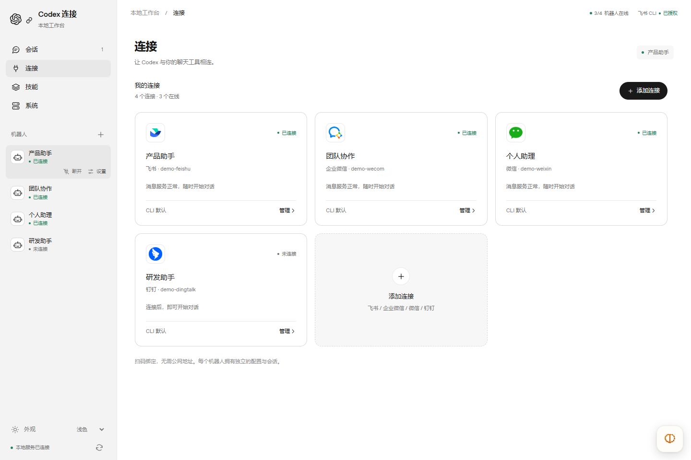
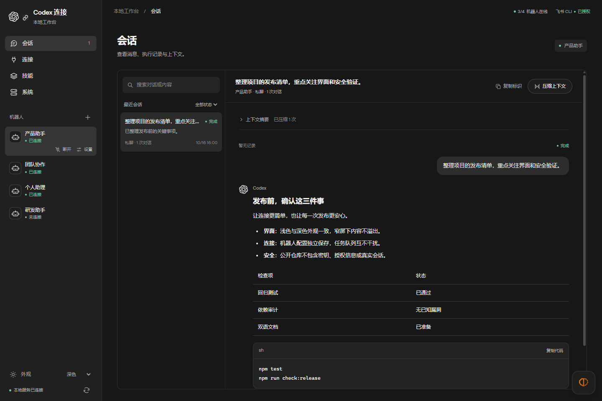
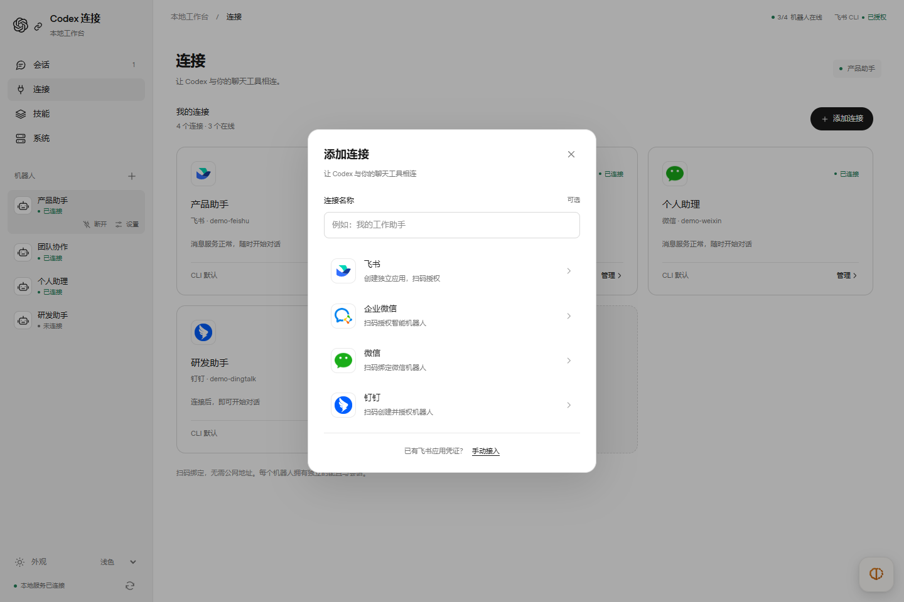
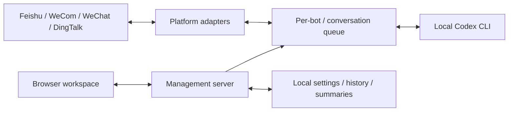

# Codex Third-Party Chat Bot Connection Manager

English · [简体中文](README.md) · [Security](SECURITY.md) · [Validation](docs/VALIDATION.md)

**Connect Codex to the chat tools you already use.**

A local, open-source workspace for Feishu/Lark, WeCom, WeChat, and DingTalk bots.
Use local Codex through chat and manage connections, history, context, skills,
and services in your browser.

> Independent third-party project, not an official OpenAI or chat-platform product.
> The interface is inspired by Codex's neutral visual language.
> All screenshots use fictional data, not live authorizations.



## Highlights

- **Quick connections:** select a platform and scan its authorization code. Manage each connection through a card; existing Feishu apps also support manual configuration.
- **Readable conversations:** search history, read Markdown, copy code, inspect errors, and compress long contexts.
- **Independent bots:** isolated settings and history, concurrency limits, and sequential execution within each conversation.
- **Central maintenance:** start, disconnect, restart, inspect logs, and update Feishu CLI / official skills.
- **Codex-inspired UI:** neutral colors, lightweight navigation, light/dark/system appearance, responsive layouts, and independent scrolling.

## Screenshots

### Conversations And Context

User messages and Codex replies are visually distinct. Headings, lists, tables,
and code blocks are supported. Raw HTML is escaped; wide content scrolls internally.
Errors remain separate from detailed diagnostics.



### Quick Binding



Bots, identifiers, paths, and messages are fictional.
See [screenshot notes](docs/screenshots/README.md).

## Platform Support

| Capability | Feishu | WeCom | WeChat | DingTalk |
| --- | --- | --- | --- | --- |
| Quick binding | CLI app creation / QR | AI bot QR | iLink bot QR | Registration QR |
| Text and isolated sessions | Yes | Yes | Yes | Yes |
| Connection cards and services | Yes | Yes | Yes | Yes |
| History and compression | Yes | Yes | Yes | Yes |
| Attachments and streaming cards | Yes | Not yet | Not yet | Not yet |
| User CLI auth and CLI/skill updates | Yes | Not applicable | Not applicable | Not applicable |

Availability depends on account permissions, organization policy, region, and
upstream APIs. Protocols and adapters have automated mock coverage;
**not all four platforms have been verified with live phone scans**.
The application UI is currently Chinese; project introductions are bilingual.

## Quick Start

Requires **Node.js 22.8+** (**24 LTS** recommended), Git, a working Codex account
or API configuration, and permission to authorize platform bots.
Dependency installation requires internet access.

```sh
git clone https://github.com/JKZeng-cell/codex-chat-bridge-manager.git
cd codex-chat-bridge-manager
npm ci
npx codex login
npm start
```

Open the [local workspace](http://127.0.0.1:3210/) manually.

1. Open Connections (连接), select Add Connection (添加连接), and complete authorization on your phone.
2. Open the connection card and set the working directory. Keep the CLI's default model or select one your account supports.
3. Save and connect. Send the bot a message; group chats use the configured command prefix, `/codex` by default.
4. Use Conversations (会话) for history and context, Skills (技能) for preferences, and System (系统) for status and updates.

Feishu CLI application configuration and user authorization are separate:
connect the CLI before authorizing user scopes. On Windows the configured global
`lark-cli` is preferred, with the project dependency as fallback.
See the [CLI guide](docs/LARK_CLI.md).

No `.env` is needed for an empty manager. Advanced users can copy
`.env.example` to `.env`. Existing `FEISHU_APP_ID` / `FEISHU_APP_SECRET`
settings seed a compatible default bot. The original `npm run bridge`
single-bot mode remains available and requires Feishu settings.

## Skills, Models, And Updates

Skills are discovered under the current user's `~/.codex/skills` and
`~/.agents/skills`. Selecting them sets bot preferences, not arbitrary remote
installation. Feishu CLI / official skill updates require networking and may modify
the global CLI or official skill directories. Conflicting binding, authorization,
or running tasks block updates.

Models come from the local Codex catalog, without any guarantee of account access.
If the catalog is unavailable, only the CLI default is offered; model names are
not guessed. Context compression stores a local summary and starts a fresh thread
on subsequent messages. Original history remains; summaries may lose detail.

## Data And Security

The manager defaults to `127.0.0.1:3210` and has no separate login.
Do not expose, proxy, or tunnel it. Chat messages can trigger local Codex actions.
Restrict users, chats, and directories, and retain sandboxing.
Read [SECURITY.md](SECURITY.md).

| Default path | Contents |
| --- | --- |
| `state/manager/` | Bot settings, binding and authorization tasks |
| `state/bots/<id>/` | Per-bot history and runtime state |
| `state/lark-cli-workconfig/` | CLI configuration and authorization |
| `runs/` | Execution logs |
| `.env` | Optional local configuration |

Environment variables can change these paths. Some credentials are plaintext;
protect these directories and backups and never commit them.
Brand images are embedded locally. Optional OpenAI Sans fonts use the official CDN
with local fallbacks when unavailable.

## Development And Validation

```sh
npm test
npm run check:release
npm audit --omit=dev
```

CI runs on Windows / Ubuntu with Node.js 22 / 24.
See [validation scope](docs/VALIDATION.md) and [contributing](CONTRIBUTING.md).
Mocked tests are not certificates of live platform authorization.



The frontend in `src/public/` is native HTML/CSS/JavaScript with no build step.
`src/managerServer.js` provides APIs and orchestration;
`src/bindingManager.js` and `src/platformAdapters.js` handle integrations.
`src/platformRuntime.js` and `src/bridgeRuntime.js` manage execution.
See the [Feishu module guide](docs/FEISHU_MODULE_WORKFLOWS.md) for advanced workflows.

## License

Original code is [MIT licensed](LICENSE). Third-party marks, fonts, and dependencies
retain their respective rights; see [NOTICE.md](NOTICE.md).
No trademark license or official endorsement is granted.
