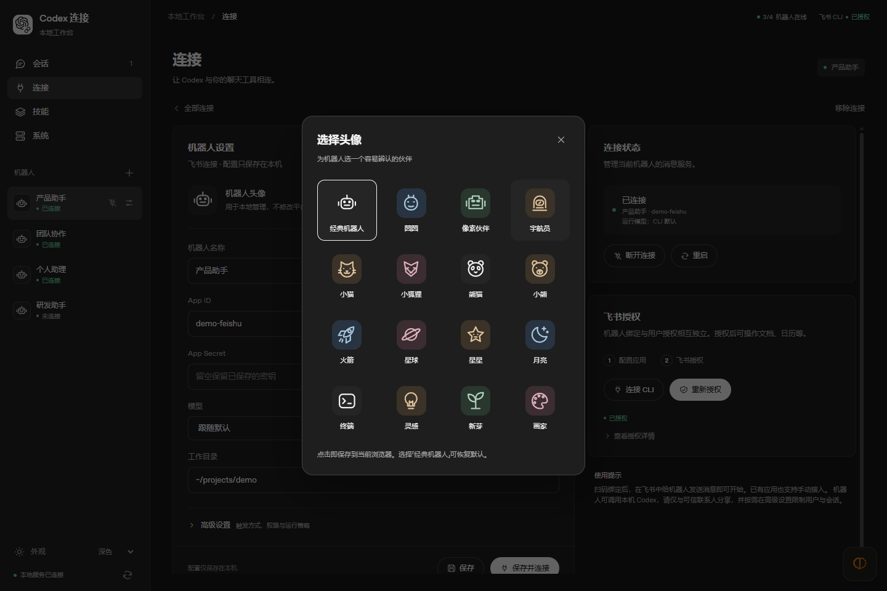
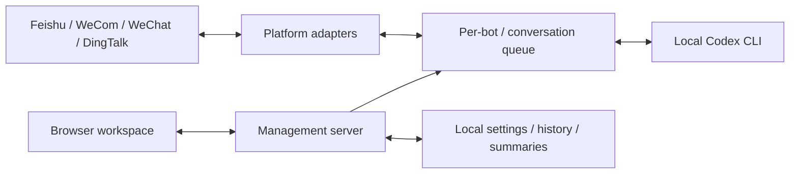

# Codex Third-Party Chat Bot Connection Manager

[简体中文](README.md) | **English**

| Language / 阅读语言 | Full Guide / 完整说明 |
| --- | --- |
| 简体中文 | [功能、安装、使用、开发与安全说明](README.md) |
| English | This page: features, installation, usage, development, and security |

[Download / 下载桌面版](https://github.com/JKZeng-cell/codex-chat-bridge-manager/releases/latest) · [Security / 安全说明](SECURITY.md) · [Validation / 验证范围](docs/VALIDATION.md)

**Connect Codex to the chat tools you already use.**

A local, open-source workspace for Feishu/Lark, WeCom, WeChat, and DingTalk bots.
Use local Codex through chat and manage connections, history, context, skills,
and services through the Windows desktop app or a local browser.

**让 Codex 与你的聊天工具相连。**

运行在本机的开源管理工具，支持飞书、企业微信、微信和钉钉机器人。
通过 Windows 桌面应用或本地浏览器管理连接、会话、上下文、技能与服务。
阅读[完整中文说明](README.md)。

> Independent third-party project, not an official OpenAI or chat-platform product.
> The interface is inspired by Codex's neutral visual language.
> All screenshots use fictional data, not live authorizations.
> 独立第三方项目，非 OpenAI 或聊天平台官方产品；截图为虚拟演示数据，管理界面目前为中文。


## Contents

- [Highlights](#highlights)
- [Screenshots](#screenshots)
- [Platform capabilities](#platform-capabilities)
- [Quick start](#quick-start): Windows desktop app / Run from source
- [Skills, models, and updates](#skills-models-and-updates)
- [Data and security](#data-and-security)
- [Development and validation](#development-and-validation)
- [License](#license)

## Highlights

- **Quick connections:** select a platform and scan its authorization code. Manage each connection through a card; existing Feishu apps also support manual configuration.
- **Readable conversations:** search history, read Markdown, copy code, inspect errors, and compress long contexts.
- **Independent bots:** isolated settings and history, concurrency limits, and sequential execution within each conversation.
- **Responsive replies:** acknowledge accepted requests, update native streams/cards on Feishu, WeCom and DingTalk, and send completed segments on WeChat.
- **Built-in office tools:** ship DingTalk DWS, WeCom CLI and 31 official skills with the desktop app. Authorize and enable per bot without global installation.
- **Personal avatars:** choose from 16 built-in designs in connection settings. Per-bot choices are saved in the current browser and shown in navigation, cards, and conversations without changing platform avatars.
- **Central maintenance:** start, disconnect, restart, inspect logs, and update Feishu CLI / official skills.
- **Runtime status:** inspect uptime, online bots, and task queues; check the Codex CLI version and login state without mistaking local login for verified model connectivity.
- **Codex-inspired UI:** neutral colors, lightweight navigation, light/dark/system appearance, responsive layouts, and independent scrolling.

## Screenshots

### Conversations And Context

User messages and Codex replies are visually distinct. Headings, lists, tables,
and code blocks are supported. Raw HTML is escaped; wide content scrolls internally.
Errors remain separate from detailed diagnostics.


### Quick Binding


Bots, identifiers, paths, and messages are fictional.
See [screenshot notes](docs/screenshots/README.md).

### Personalize Your Bots

Open Connections → Bot Settings → Change Avatar (更换头像) and choose a design.
Choices are saved per bot in the current browser and reflected in navigation,
cards, and conversations. Select the classic robot to restore the default.
Chat-platform profile images are not modified.



## Platform Capabilities

| Capability | Feishu | WeCom | WeChat | DingTalk |
| --- | --- | --- | --- | --- |
| Quick binding | CLI app creation / QR | AI bot QR | iLink bot QR | Registration QR |
| Text and isolated sessions | Yes | Yes | Yes | Yes |
| Connection cards and services | Yes | Yes | Yes | Yes |
| History and compression | Yes | Yes | Yes | Yes |
| Receipt acknowledgement | Yes | Yes | Yes | Yes |
| Streaming replies | Cards | In-place stream | Completed segments | AI cards; text fallback |
| Attachments | Yes | Not yet | Not yet | Not yet |
| CLI authorization | Feishu CLI | WeCom CLI | Not applicable | DingTalk DWS |
| CLI/skill distribution | Bundled; official Feishu updater | Bundled; application updates | Not applicable | Bundled; application updates |

Availability depends on account permissions, organization policy, region, and
upstream APIs. Protocols and adapters have automated mock coverage;
**not all four platforms have been verified with live phone scans**.
The application UI is currently Chinese; project introductions are bilingual.

## Quick Start

### Windows Desktop App

See the [v1.0.5 replies and CLI notes](docs/releases/v1.0.5.md). The Release page is authoritative for published packages.
Local installer repairs are documented in the [v1.0.6 notes](docs/releases/v1.0.6.md).
See the [v1.0.7 reply repair notes](docs/releases/v1.0.7.md) for DingTalk/WeCom delivery changes.

Download the Windows x64 Setup.exe or Portable.exe from
[GitHub Releases](https://github.com/JKZeng-cell/codex-chat-bridge-manager/releases/latest).
Electron, Codex CLI, Feishu CLI, DingTalk DWS, WeCom CLI and matching official
skills are bundled. No separate Node.js or global CLI installation is required.
Use Application → Codex Login (应用 → Codex 登录) for authorization.

Desktop data lives separately under `%APPDATA%/CodexChatBridgeManager`; the local
manager uses port 3211 and does not import the web workspace's `.env`, bots,
history, or Feishu CLI credentials. Existing system-user Codex authorization can
be reused. The portable build uses the same application-data directory rather
than placing credentials beside the executable.

Packages are currently unsigned. Windows may show an unknown-publisher warning.
Allow at least 2 GB of free space on the temporary-files drive for extraction.
Starting with 1.0.6, Setup requests administrator permission to update legacy
installations in Program Files; the application itself still runs unelevated.
When temporary space is low, Setup tries a private directory on the installation
drive without changing system TEMP settings. Permission/space errors are reported
before removing the old version; configuration, history and authorization remain.
Download only from this repository and verify SHA-256 checksums. Wait for active
tasks and tool updates before quitting; exiting stops the desktop-managed service.

Minimizing or closing the window hides it to the system tray while bot services
continue running. Click or double-click the tray icon to restore the workbench.
Use the tray's Exit action or Application → Exit to stop services. Active tasks
still block exit. If tray creation fails, window close falls back to normal exit
instead of leaving an inaccessible background application. Installer updates use
a separate protected quit request rather than the window-hide action.

### Run From Source

Requires **Node.js 22.12+** (**24 LTS** recommended), Git, a working Codex account
or API configuration, and permission to authorize platform bots.
Dependency installation requires internet access.

```sh
git clone https://github.com/JKZeng-cell/codex-chat-bridge-manager.git
cd codex-chat-bridge-manager
npm ci
npx codex login
npm start
```

Open the [local workspace](http://127.0.0.1:3210/) manually.

1. Open Connections (连接), select Add Connection (添加连接), and complete authorization on your phone.
2. Open the connection card and set the working directory. Keep the CLI's default model or select one your account supports.
3. Save and connect. Send the bot a message; group chats use the configured command prefix, `/codex` by default.
4. Use Conversations (会话) for history and context, Skills (技能) for preferences, and System (系统) for status and updates.

Feishu CLI application configuration and user authorization are separate:
connect the CLI before authorizing user scopes. On Windows the configured global
`lark-cli` is preferred, with the project dependency as fallback.
See the [CLI guide](docs/LARK_CLI.md).

No `.env` is needed for an empty manager. Advanced users can copy
`.env.example` to `.env`. Existing `FEISHU_APP_ID` / `FEISHU_APP_SECRET`
settings seed a compatible default bot. The original `npm run bridge`
single-bot mode remains available and requires Feishu settings.

## Replies And Platform CLIs

Only messages that pass allowlists/trigger rules and enter the persisted queue receive
an acknowledgement; duplicates do not rerun tasks. Enable Streaming Replies (流式回复)
in Advanced Settings to publish public answer events, never reasoning or command logs.
Updates are throttled and finalized in order. WeChat sends completed segments instead
of editable/token-by-token messages. Disabling streaming retains receipt and final
replies. Actual incremental output depends on events emitted by Codex CLI.
DingTalk requires interactive-card write and AI streaming-update permissions; failures
fall back to text without silently discarding the result.

Platform CLI authorization is separate from bot binding and does not copy existing
CLI credentials:

1. Open the DingTalk/WeCom connection settings. The panel detects bundled versions and skills automatically.
2. Click Authorize CLI (授权 CLI) and complete the official phone flow; Check (检测) refreshes an existing authorization.
3. Click Enable And Connect (启用并连接). Platform CLI (平台 CLI) in Advanced Settings remains available as a manual switch. Enterprise permissions and write confirmations still apply.
4. Matching built-in skills are offered to Codex automatically. The Skills page labels them as built-in; personal skill selections remain available. Existing `.codex/skills` and `.agents/skills` are not overwritten.

Desktop distributions pin [WeCom CLI 1.3.4](https://github.com/WecomTeam/wecom-cli)
with 15 official skills and [DingTalk DWS 1.0.65](https://github.com/DingTalk-Real-AI/dingtalk-workspace-cli)
with 16 skills. Sources, versions and artifact integrity values live in
`build/platform-tools.lock.json`; tools/skills update with the application.
Source users can prepare the same resources with `node scripts/platform-tools.js`.
This integration requires WeCom CLI >= 1.2.1 and DWS >= 1.0.65. Each bot uses
`bots/<bot-id>/cli/<platform>` inside the application state directory.
Set `WECOM_CLI_BIN` / `DINGTALK_CLI_BIN` to an official native executable when needed;
`.cmd`, `.bat` and `.ps1` launchers are not supported. The desktop app only uses its
bundled tools and reports missing files rather than silently falling back to a global
installation. Source mode permits explicit compatible binaries. Global installation
commands and changes to user skill directories are not automatically executed.

## Skills, Models, And Updates

Skills are discovered under the current user's `~/.codex/skills` and
`~/.agents/skills`. Selecting them sets bot preferences, not arbitrary remote
installation. Feishu CLI / official skill updates require networking and may modify
the global CLI or official skill directories. Conflicting binding, authorization,
or running tasks block updates.

Models come from the local Codex catalog, without any guarantee of account access.
If the catalog is unavailable, only the CLI default is offered; model names are
not guessed. Context compression stores a local summary and starts a fresh thread
on subsequent messages. Original history remains; summaries may lose detail.

## Data And Security

Source mode defaults to `127.0.0.1:3210`; the desktop app uses `127.0.0.1:3211`.
The management interface has no separate login.
Do not expose, proxy, or tunnel it. Chat messages can trigger local Codex actions.
Restrict users, chats, and directories, and retain sandboxing.
Read [SECURITY.md](SECURITY.md).

The following paths are source-mode defaults. Desktop data lives separately in
`%APPDATA%/CodexChatBridgeManager`, without automatic import of source-mode settings,
bots, conversations, or Feishu CLI credentials.

| Source-mode default path | Contents |
| --- | --- |
| `state/manager/` | Bot settings, binding and authorization tasks |
| `state/bots/<id>/` | Per-bot history and runtime state |
| `state/lark-cli-workconfig/` | CLI configuration and authorization |
| `runs/` | Execution logs |
| `.env` | Optional local configuration |

Environment variables can change source-mode paths. Some credentials are plaintext;
protect these directories and backups and never commit them.
Brand images are embedded locally. Optional OpenAI Sans fonts use the official CDN
with local fallbacks when unavailable.

## Development And Validation

On Windows x64, run `npm ci` followed by `npm run desktop:dist`; artifacts are
written to `dist/`. Packaging uses an explicit source/tool allowlist and excludes
local settings, history, credentials, logs, and smoke-test directories.

```sh
npm test
npm run check:release
npm audit --omit=dev
```

CI runs on Windows / Ubuntu with Node.js 22 / 24.
See [validation scope](docs/VALIDATION.md) and [contributing](CONTRIBUTING.md).
Mocked tests are not certificates of live platform authorization.



The frontend in `src/public/` is native HTML/CSS/JavaScript with no build step.
`src/managerServer.js` provides APIs and orchestration;
`src/bindingManager.js` and `src/platformAdapters.js` handle integrations.
`src/platformRuntime.js` and `src/bridgeRuntime.js` manage execution.
See the [Feishu module guide](docs/FEISHU_MODULE_WORKFLOWS.md) for advanced workflows.

## License

Original code is [MIT licensed](LICENSE). Third-party marks, fonts, and dependencies
retain their respective rights; see [NOTICE.md](NOTICE.md).
No trademark license or official endorsement is granted.
