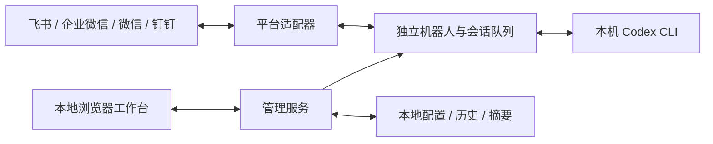

# CODEX第三方对话机器人连接管理器

**简体中文** | [English](README.en.md)

| 阅读语言 / Language | 完整说明 / Full Guide |
| --- | --- |
| 简体中文 | 本页：功能、安装、使用、开发与安全说明 |
| English | [Features, installation, usage, development, and security](README.en.md) |

[下载桌面版 / Download](https://github.com/JKZeng-cell/codex-chat-bridge-manager/releases/latest) · [安全说明 / Security](SECURITY.md) · [验证范围 / Validation](docs/VALIDATION.md)

**让 Codex 与你的聊天工具相连。**

运行在本机的开源工作台：集中管理飞书、企业微信、微信、钉钉机器人，在聊天工具中使用
本机 Codex，在浏览器中管理连接、会话、上下文、技能与服务。

**Connect Codex to the chat tools you already use.**

A local, open-source manager for Feishu/Lark, WeCom, WeChat, and DingTalk bots.
Manage connections, conversations, context, skills, and services through the
Windows desktop app or a local browser. See the [complete English guide](README.en.md).

> 独立第三方项目，非 OpenAI 或聊天平台官方产品。界面参考 Codex 的黑白灰视觉语言。
> 所有截图使用虚拟演示数据，不代表真实授权状态。
> Independent third-party project, not an official OpenAI or chat-platform product.
> Screenshots use fictional demo data. The application UI is currently Chinese.


## 目录

- [核心能力](#核心能力)
- [界面预览](#界面预览)
- [平台支持](#平台支持)
- [快速开始](#快速开始)：Windows 桌面版 / 从源码运行
- [技能、模型与更新](#技能模型与更新)
- [数据与安全](#数据与安全)
- [开发与验证](#开发与验证)
- [许可](#许可)

## 核心能力

- **快捷连接**：选择平台并扫码；卡片式管理多个连接，飞书也支持已有应用手动接入。
- **清晰会话**：搜索历史、阅读 Markdown、复制代码、查看错误详情、压缩长会话上下文。
- **独立机器人**：配置与历史分开保存，队列限制并发，同一会话顺序执行。
- **个性头像**：连接设置提供 16 款内置头像，自动保存在当前浏览器，同步显示于侧栏、连接卡片与会话；不会修改聊天平台头像。
- **集中维护**：启动、断开、重启服务，查看日志，更新飞书 CLI 与官方技能。
- **运行状态**：查看服务运行时长、在线机器人和任务队列；检测 Codex CLI 版本与登录状态，登录成功不等于模型网络连通已验证。
- **Codex 风格**：黑白灰、轻量侧栏、浅色/深色/跟随系统，窄屏自适应与区域独立滚动。

## 界面预览

### 阅读会话，保持上下文清晰

用户消息与 Codex 回复分层呈现，支持标题、列表、表格与代码块。原始 HTML 不执行，
长代码和宽表格内部滚动，错误摘要与详细日志分开显示。


### 一个入口，添加多种连接


机器人、标识、路径和消息均为虚拟数据，见 [截图说明](docs/screenshots/README.md)。

### 个性化机器人头像

在「连接 → 机器人设置 → 更换头像」中选择，点击即保存到当前浏览器，
侧栏、连接卡片和会话同步更新。可选经典机器人恢复默认；不会修改聊天平台头像。


## 平台支持

| 能力 | 飞书 | 企业微信 | 微信 | 钉钉 |
| --- | --- | --- | --- | --- |
| 快捷绑定 | CLI 创建应用/扫码 | 智能机器人扫码 | iLink 机器人扫码 | 扫码注册机器人 |
| 文本消息与独立会话 | 支持 | 支持 | 支持 | 支持 |
| 连接卡片与服务控制 | 支持 | 支持 | 支持 | 支持 |
| 历史与上下文压缩 | 支持 | 支持 | 支持 | 支持 |
| 附件、流式卡片 | 支持 | 暂不支持 | 暂不支持 | 暂不支持 |
| 用户 CLI 授权与 CLI/Skill 更新 | 支持 | 不适用 | 不适用 | 不适用 |

平台接口、地区、企业策略与账号权限可能影响可用性。绑定协议与消息适配有模拟测试，
**不代表四个平台均已完成实机扫码验证**。管理界面目前为中文，项目介绍提供中英双语。

## 快速开始

### Windows 桌面版

本次功能更新见 [v1.0.4 托盘运行说明](docs/releases/v1.0.4.md)。

从 [GitHub Release](https://github.com/JKZeng-cell/codex-chat-bridge-manager/releases/latest) 下载
Windows x64 安装版（Setup.exe）或免安装版（Portable.exe）。内置 Electron、Codex CLI
与飞书 CLI，无需另装 Node.js。首次使用可通过菜单「应用 → Codex 登录」授权。

应用数据独立保存在 `%APPDATA%/CodexChatBridgeManager`，管理服务仅监听本机 3211 端口，
不读取网页工作台的 `.env`、机器人、会话或 CLI 授权目录。Codex 可使用当前系统用户已有的
Codex 授权；免安装版同样使用上述数据目录，不将凭据写在程序旁。

当前应用包未进行代码签名，Windows 可能显示来源提示。仅从本仓库下载并核对 SHA-256。
安装和免安装版解压建议临时目录所在磁盘至少保留 2 GB 可用空间。
最小化或点击窗口关闭按钮会隐藏到系统托盘，机器人服务继续在后台运行。
点击或双击托盘图标可恢复工作台；右键托盘选择「退出」，或使用「应用 → 退出」可停止服务。
退出时仍会保护执行中的任务与工具更新，请先等待完成。系统托盘不可用时，关闭窗口会正常退出，
不会留下无法恢复的隐藏窗口。安装更新使用独立退出请求，不会把“隐藏到托盘”误当成已经退出。

### 从源码运行

需要 **Node.js 22.12+**（推荐 **24 LTS**）、Git、可用的 Codex 账号或 API 配置，
以及有权创建/授权机器人的平台账号。安装依赖需要联网。

```sh
git clone https://github.com/JKZeng-cell/codex-chat-bridge-manager.git
cd codex-chat-bridge-manager
npm ci
npx codex login
npm start
```

手动打开 [本地工作台](http://127.0.0.1:3210/)，服务不会自动打开浏览器。

1. 进入“连接”，点击“添加连接”，选择平台并在手机完成扫码和权限确认。
2. 点击连接卡片设置工作目录；模型默认跟随本机 CLI，也可选择账号可用模型。
3. 保存并连接，在聊天工具向机器人发送消息；群聊使用命令前缀，默认 `/codex`。
4. “会话”查看历史与压缩摘要，“技能”选择偏好，“系统”查看状态和更新工具。

飞书 CLI 的应用配置与用户授权分开：先连接 CLI，再授权文档、日历等用户能力。
Windows 优先使用已配置的全局 `lark-cli`，没有时使用项目依赖，见 [CLI 指南](docs/LARK_CLI.md)。

空白工作台无需 `.env`。高级配置可复制 `.env.example` 为 `.env`；
已有 `FEISHU_APP_ID` / `FEISHU_APP_SECRET` 会兼容加载为默认机器人。
旧单机器人模式 `npm run bridge` 仍保留，需要相应飞书环境变量。

## 技能、模型与更新

技能从当前用户的 `~/.codex/skills`、`~/.agents/skills` 读取，勾选设置机器人偏好，
不等于安装任意远程技能。飞书 CLI/官方技能更新需要联网，可能修改全局 CLI 与官方技能目录；
绑定、授权或任务执行中会阻止冲突更新。

模型列表读取本机 Codex 目录缓存，不保证账号支持；缓存不可用时仅提供“跟随默认”，
不猜测模型名称。上下文压缩保存本地摘要，并在后续消息创建新线程；原始历史保留，
但摘要可能丢失细节。

## 数据与安全

源码版默认监听 `127.0.0.1:3210`，桌面版使用 `127.0.0.1:3211`。
管理界面没有独立登录，请勿公网暴露、代理或穿透。
机器人消息可以触发本机操作，应限制可信用户、会话和工作目录，保留 Codex 沙箱。
详细限制见 [安全说明](SECURITY.md)。

以下为源码版的默认路径；桌面版数据独立保存在 `%APPDATA%/CodexChatBridgeManager`，
不会自动导入源码版的配置、机器人、会话或飞书 CLI 授权。

| 源码版默认本地路径 | 用途 |
| --- | --- |
| `state/manager/` | 配置、绑定与授权任务 |
| `state/bots/<id>/` | 各机器人会话及运行状态 |
| `state/lark-cli-workconfig/` | 飞书 CLI 配置和授权 |
| `runs/` | 执行日志 |
| `.env` | 可选本机配置 |

源码版路径可由环境变量更改。部分凭据以明文保存，请保护目录和备份，勿上传至 GitHub。
官方平台图标本地内嵌；可选 OpenAI Sans 字体访问官方 CDN，断网时使用本机字体。

## 开发与验证

Windows x64 桌面构建：`npm ci` 后运行 `npm run desktop:dist`，产物在 `dist/`。
打包明确列出允许收录的源码与运行工具，不包含本机配置、历史、授权、日志或截图测试目录。

```sh
npm test
npm run check:release
npm audit --omit=dev
```

CI 在 Windows / Ubuntu、Node.js 22 / 24 上运行。
实际验证与未覆盖的实机范围见 [验证报告](docs/VALIDATION.md)。
欢迎阅读 [贡献指南](CONTRIBUTING.md)。



前端 `src/public/` 使用原生 HTML/CSS/JavaScript，无构建步骤。
管理入口 `src/managerServer.js`；绑定与消息在 `src/bindingManager.js`、
`src/platformAdapters.js`；执行在 `src/platformRuntime.js`、`src/bridgeRuntime.js`。
进阶飞书能力见 [模块工作流](docs/FEISHU_MODULE_WORKFLOWS.md)。

## 许可

原创代码使用 [MIT](LICENSE) 许可。第三方标志、字体及依赖保留各自权利，
见 [第三方声明](NOTICE.md)。不授予品牌商标许可。
